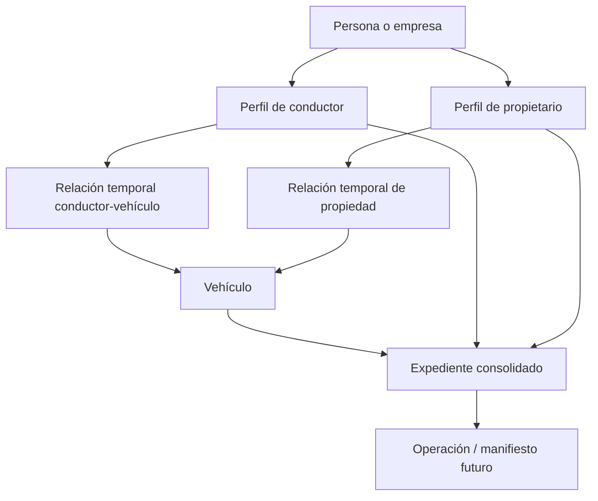

# Capital Cargo — Plan maestro del ERP

**Versión:** 1.0 · 23 de octubre de 2026  
**Estado:** Propuesta de producto y arquitectura, pendiente de validación con operaciones.

## 1. Visión

Construir de manera incremental un ERP logístico de Capital Cargo: una fuente confiable para personas, empresas, vehículos, documentos, relaciones, validaciones y operaciones de transporte. Cada entidad tiene un **perfil único** y un **historial trazable**. Una vista de **expediente consolidado** reúne información relacionada, sin duplicarla.

El producto comienza como backoffice para administrativos, pero se diseña para permitir en el futuro que conductores y propietarios soliciten actualizaciones mediante un portal seguro o enlaces enviados por WhatsApp.

### Principios no negociables

1. **Una fuente por dato:** conductor, propietario y vehículo no se duplican dentro de cada expediente.
2. **Relaciones temporales:** un conductor puede conducir varios vehículos a lo largo del tiempo; un vehículo puede cambiar de propietario.
3. **Trazabilidad por defecto:** registrar quién, cuándo, desde qué canal, qué cambió y por qué.
4. **Validación separada de captura:** documento cargado no significa aprobado; RUNT consultado no significa resultado satisfactorio.
5. **Permisos mínimos:** datos financieros e identificación con acceso restringido.
6. **Modularidad:** habilitar funciones gradualmente, conservando una arquitectura coherente.

## 2. Usuarios y experiencias

| Usuario | Ahora | Después |
|---|---|---|
| Administrativo | Crear, buscar, revisar, corregir y validar expedientes | Operar viajes, manifiestos y conciliaciones |
| Conductor | Sin acceso directo al backoffice | Consultar datos propios y solicitar cambios autenticados |
| Propietario | Sin acceso directo al backoffice | Consultar sus vehículos y solicitar modificaciones |
| Servicios automáticos | Consultas externas controladas | Validaciones, alertas e integraciones con ERP Sysran |

**Decisión de diseño:** la administración sigue siendo exclusiva del personal interno; la autogestión externa sería un portal separado con permisos limitados, no acceso al panel administrativo.

## 3. Modelo funcional

### Entidades recomendadas

| Entidad | Propósito / campos guía |
|---|---|
| `parties` | Persona natural o jurídica, documento/NIT, nombre o razón social, contactos |
| `drivers` | Atributos propios del conductor, vinculados a `party_id` |
| `owners` | Atributos del propietario, vinculados a `party_id` |
| `vehicles` | ID interno, placa normalizada, tipo, datos técnicos |
| `driver_vehicle_assignments` | `driver_id`, `vehicle_id`, vigencia desde/hasta, tipo de vínculo |
| `vehicle_ownerships` | `owner_id`, `vehicle_id`, vigencia desde/hasta, soporte |
| `documents` / `document_versions` | Tipo, entidad titular, objeto, versión, validez, revisión, almacenamiento protegido |
| `validation_runs` | Proveedor, entidad, fecha, estado técnico, resultado de negocio, referencia de respuesta |
| `change_requests` | Solicitante, cambios propuestos, evidencia, estado, revisor, resolución |
| `audit_events` | Actor, acción, entidad, fecha, canal, origen y diferencias autorizadas |
| `users` / `roles` | Identidad autenticada y permisos; admitir futuros usuarios externos |
| `operations` (futuro) | Servicio, origen/destino, fechas, vehículo y conductor asignados |
| `integration_jobs` (futuro) | Estado e intentos de sincronización con Sysran |

El **expediente** es primordialmente una vista consolidada que consulta las entidades y sus relaciones. Si se requiere congelar evidencia para un manifiesto, guardar una *instantánea inmutable* de datos operativos al momento de la emisión.

### Reglas de integridad

- Definir unicidad de identificaciones por tipo de documento y de placa normalizada, considerando datos erróneos o temporales durante importaciones.
- No fusionar registros automáticamente por nombre o placa: revisar posibles duplicados.
- Mantener historial de vigencias y evitar superposiciones incompatibles de propiedad/relaciones según reglas del negocio.
- No borrar físicamente información de auditoría ni documentos relevantes para obligaciones vigentes; definir política de retención y eliminación aplicable.

## 4. Historias y procesos principales

### A. Registrar y revisar

1. Administrativo recibe o crea perfil.
2. Sistema detecta posibles duplicados y crea/actualiza entidades correctas.
3. Vincula conductor, propietario y vehículo sin copiar información entre perfiles.
4. Documentos se cargan y pasan por estados `faltante → recibido → en revisión → aprobado/rechazado/vencido`.
5. RUNT u otra validación registra estado técnico y resultado de negocio por separado.
6. Se aprueba el perfil o se muestra exactamente qué bloquea la aprobación.

### B. Solicitud de cambio desde el conductor (futuro)

1. Conductor verifica su identidad en un portal o enlace seguro, de corta duración.
2. Solicita un cambio; no sobrescribe de inmediato datos sensibles.
3. Sistema conserva valores actuales, cambios propuestos y evidencia.
4. Según política: verifica automáticamente o envía a bandeja administrativa.
5. Administrador aprueba/rechaza con motivo; el sistema aplica cambios aprobados de forma transaccional.
6. Auditoría registra actor solicitante, aprobador, canal, antes/después y fecha.

**Política inicial propuesta:** teléfono y dirección con validaciones ligeras; email exige verificación; cédula, licencia, cuenta bancaria y vínculos de vehículo exigen revisión explícita. Validar con operaciones antes de implementar.

### C. Consultar historia

En cada perfil mostrar dos líneas de tiempo distintas:

- **Auditoría:** creación, edición, aprobación, rechazo, usuario y canal.
- **Historia operativa:** licencias y documentos vigentes en cada periodo, vínculos a vehículos, cambios de propietario y después manifiestos/viajes.

## 5. Mapa futuro del producto

| Módulo | Objetivo | Dependencia |
|---|---|---|
| Maestros y expedientes | Conductores, propietarios, vehículos, relaciones | Base inicial |
| Documentos y validaciones | Carga, revisión, vigencia, RUNT, alertas | Maestros |
| Solicitudes de cambio | Autogestión controlada y aprobaciones | Identidad, auditoría y documentos |
| Operaciones | Servicios, asignaciones, viajes y novedades | Maestros aprobados |
| Manifiestos / integración Sysran | Envío, confirmación, errores y reconciliación | Operaciones |
| Seguimiento | Estado y última ubicación, donde exista autorización y fuente válida | Operaciones |
| Facturación y gastos | Control financiero y conciliaciones | Operaciones y políticas contables |
| Analítica | Calidad, productividad, cumplimiento y KPIs | Eventos y datos confiables |

## 6. Roadmap por entregables (sin fechas inventadas)

### Fase 0 — Definición de negocio

- Confirmar identificadores, documentos requeridos y excepciones por tipo de actor/vehículo.
- Acordar definición de **aprobado**, **pendiente**, **documento completo** y **novedad RUNT**.
- Acordar reglas de vinculación múltiple, vigencias y quién puede aprobar.
- Inventariar datos existentes y estrategia de migración sin perder referencias.

**Salida:** diccionario de datos, diagrama de entidades, estados y matriz de permisos aprobados.

### Fase 1 — Primer módulo utilizable

- Perfiles separados y expediente agrupado; búsqueda, filtros, tablas, detalle y edición.
- Corrección de conteos y duplicados aparentes.
- Separar estados de registro, documentos, RUNT y validación.
- Implementar auditoría básica de escrituras desde el comienzo.

**Salida:** backoffice que permite localizar una entidad y entender su expediente en segundos. Ver `Capital_Cargo_Modulo_1_Plan_de_Mejora.md`.

### Fase 2 — Documentos y controles

- Versionado documental, vista previa segura, revisión y fechas de vencimiento.
- Consultas y resultados de validaciones con manejo de errores y reintentos.
- Alertas priorizadas y cola de revisión administrativa.

### Fase 3 — Autogestión

- Autenticación de externos, solicitud de cambios, aprobaciones y notificaciones.
- WhatsApp únicamente como canal de notificación/entrada; documentos sensibles mediante portal autenticado.

### Fase 4 — Operaciones e integraciones

- Servicios, asignaciones, manifiestos, estado de sincronización con Sysran y tratamiento de errores.
- Conciliación entre lo enviado y lo confirmado por el sistema receptor.

### Fase 5 — Gestión empresarial ampliada

- Seguimiento, finanzas, tableros y automatización en función de la operación real.

## 7. Seguridad, datos y operación técnica

- Autenticación robusta; roles aunque inicialmente solo haya administrativos; MFA para tareas críticas.
- Autorización comprobada en backend por entidad y operación; nunca confiar solamente en botones ocultos.
- Cifrado en tránsito y almacenamiento; archivos privados con URLs temporales; no exponer cuentas completas en tablas o logs.
- Auditoría de eventos en servidor, no editable desde el frontend; usar `actor_id`, `channel`, `request_id`, marca temporal UTC y diferencias filtradas de secretos.
- Registrar IP/dispositivo solo cuando sea necesario, con política de acceso y retención.
- Backups probados, restauración, monitoreo, alertas y gestión de fallos de integraciones.
- Validar tratamiento de datos personales, finalidad, consentimiento o base aplicable y política de conservación conforme a asesoría jurídica colombiana.
- Definir contratos de API, pruebas, migraciones de base de datos y ambientes separados.

## 8. Indicadores de éxito

- Tiempo mediano para encontrar un perfil y sus relaciones.
- Porcentaje de expedientes realmente completos y aprobados (separados).
- Solicitudes pendientes por antigüedad y motivo.
- Documentos próximos a vencer.
- Porcentaje de consultas externas exitosas, con novedades y errores técnicos.
- Posibles duplicados detectados y resueltos.
- Más adelante: tasa de sincronización exitosa con Sysran y tiempo hasta manifiesto.

## 9. Preguntas que faltan por resolver

1. ¿Un conductor puede estar asociado a múltiples vehículos al mismo tiempo? ¿Con qué tipo de vínculo?
2. ¿Se registrarán tenedores/poseedores además de propietarios?
3. ¿Qué documentos son obligatorios por entidad y por tipo de vehículo?
4. ¿Qué datos puede cambiar una persona sin aprobación?
5. ¿Quién autoriza documentos, relaciones y cambios sensibles?
6. ¿Qué operaciones exactas debe intercambiar Capital Cargo con Sysran y por qué mecanismo soportado?
7. ¿Qué retención documental y medidas de acceso exige la operación?

## 10. Fuera del alcance inmediato

Portal público, WhatsApp automatizado, creación de manifiestos, facturación, GPS, módulos contables y analítica avanzada. Se contemplan arquitectónicamente, pero no bloquearán la entrega del primer módulo.
